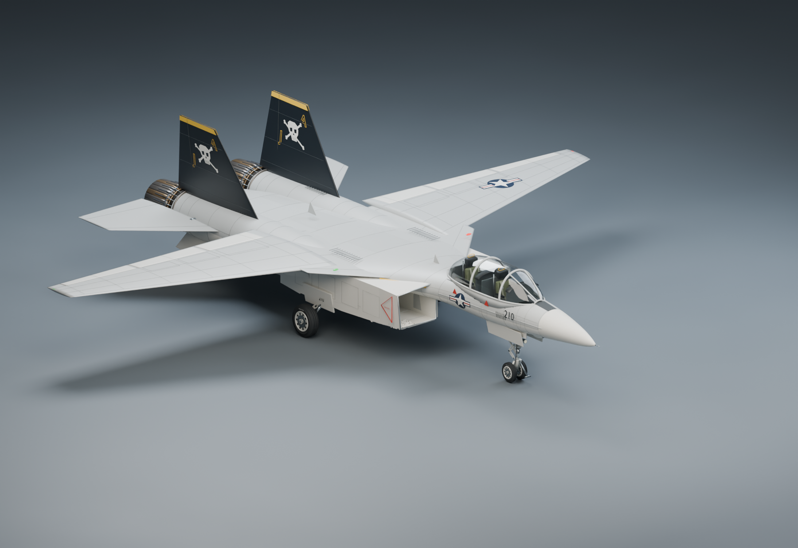
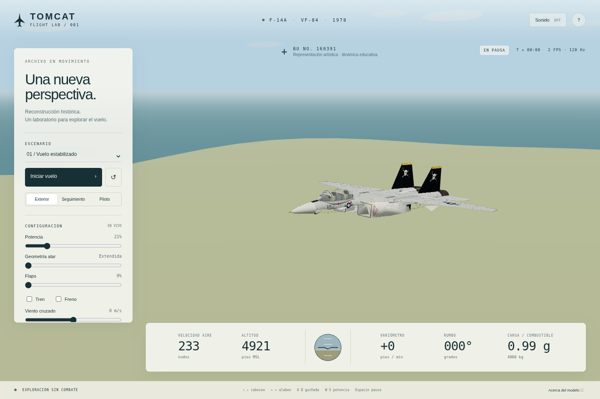

# flight — Project Tomcat

Reconstrucción artística editable de un **Grumman F-14A Tomcat**, inspirada en BuNo 160391 / VF-84 / hacia 1978, y un nuevo **laboratorio de vuelo interactivo offline**. Conserva el archivo de Blender, código regenerable, referencias y once renders originales.



## Publicación web con GitHub Pages

URL prevista: **https://alvarodesigns34.github.io/flight/**. El workflow `Deploy flight lab to Pages` construye y publica únicamente los archivos del navegador, con rutas relativas compatibles con `/flight/`. Se ejecuta al actualizar `main` o `codex/tomcat-flight-simulator` y también admite lanzamiento manual. El entorno `github-pages` debe permitir la rama desde la que se ejecute. El despliegue no requiere el servidor Python ni publica el archivo maestro Blender.

## Volar en el laboratorio



Descarga y extrae el [paquete del simulador](downloads/TOMCAT_FLIGHT_LAB.zip?raw=true), o clona esta rama. Con **Python 3.10+**, desde la raíz del repositorio:

```sh
python3 simulator/serve.py
```

En Windows: `py -3 simulator/serve.py`. Abre **http://127.0.0.1:5173** en un navegador con WebGL 2 y pulsa **Iniciar vuelo**. No necesitas Blender, Node ni conexión a internet para usar la versión entregada. Dentro del ZIP, ejecuta `python3 serve.py` o el lanzador de tu sistema.

Flechas: cabeceo y alabeo · A/D: guiñada · W/S: potencia · Espacio: pausa · R: reiniciar · C: cámara. El panel controla alas, flaps, tren, freno y viento, y permite descargar telemetría. Incluye tres escenarios, cámaras exterior/seguimiento/piloto y sonido sintetizado opcional.

**Dinámica genérica educativa de seis grados de libertad**, separada de la reconstrucción visual. Los parámetros son estimados: no se reproducen prestaciones verificadas del F-14A o de motores TF30. Sin armamento, sistemas tácticos o combate. El proyecto original sigue conservado.

[Instrucciones y controles](simulator/README.md) · [Arquitectura](SIMULATION_DESIGN.md) · [Modelo físico y procedencia](FLIGHT_MODEL.md) · [Validación y límites](VALIDATION_REPORT.md) · [Continuación](CONTINUATION.md)

## Descargar y ver el modelo

1. Descarga el [archivo principal de Blender](PROJECT_TOMCAT/F14A_TOMCAT_MASTER.blend?raw=true) o el [paquete completo ZIP](downloads/PROJECT_TOMCAT.zip?raw=true).
2. Abre el archivo `.blend` con **Blender 4.3 o posterior** mediante **Archivo → Abrir**.
3. Pulsa **0 del teclado numérico** para ver la cámara preparada. Gira con el botón central del ratón y acerca o aleja con la rueda.

El modelo ya está construido; no es necesario ejecutar el generador para verlo. GitHub ofrece la descarga del archivo Blender, sin un visor 3D integrado para este formato.

## Contenido

- [Modelo editable](PROJECT_TOMCAT/F14A_TOMCAT_MASTER.blend)
- [Código fuente y módulos](PROJECT_TOMCAT/src/)
- [Hoja de contacto de las once vistas](PROJECT_TOMCAT/renders/CONTACT_SHEET.jpg)
- [Investigación, medidas y referencias](PROJECT_TOMCAT/RESEARCH_AND_REFERENCES.md)
- [Informe de construcción y limitaciones](PROJECT_TOMCAT/BUILD_REPORT.md)
- [Revisión visual](PROJECT_TOMCAT/VISUAL_REVIEW.md)
- [Instrucciones completas de generación](PROJECT_TOMCAT/README.md)

## Regenerar y renderizar

Desde la raíz del repositorio, con Blender disponible en el PATH:

```sh
cd PROJECT_TOMCAT
blender -b --factory-startup -t 3 --python-exit-code 1 --python src/build.py
blender -b F14A_TOMCAT_MASTER.blend -t 3 --python-exit-code 1 --python src/render.py -- all 1600 64
```

La distribución oficial de Blender incluye OpenImageDenoise. Algunas compilaciones del sistema no lo incluyen; las instrucciones completas describen cómo renderizar en ese caso.

## Alcance y referencias

La envolvente general está ajustada a dimensiones publicadas. Cabina, tren, panelización e interiores contienen reconstrucciones aproximadas, documentadas en el informe. **No se acredita precisión museística exacta ni un activo cinematográfico terminado.** La escena es estática, sin armamento, simulación o sistemas operativos.

Las fotografías documentales conservan sus autores y licencias en [credits.json](PROJECT_TOMCAT/resources/references/credits.json) y en la [investigación](PROJECT_TOMCAT/RESEARCH_AND_REFERENCES.md). Las referencias no son dependencias externas para renderizar el avión.

## Desarrollar y validar la nueva fase

```sh
npm ci
npm test
npm run build
npm run validate
python3 -m unittest discover -s simulator/tests -p 'test_*.py'
```

Consulta [el informe de construcción de simulación](BUILD_REPORT.md). El ZIP histórico `PROJECT_TOMCAT.zip` conserva la entrega estática original; el nuevo paquete del laboratorio está separado.
